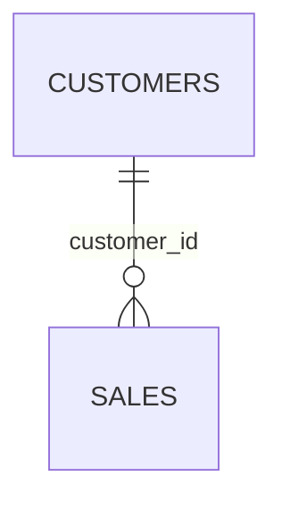
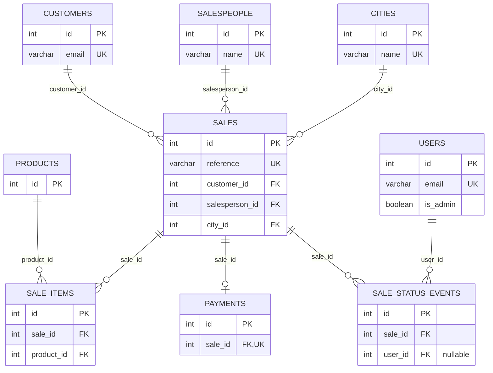
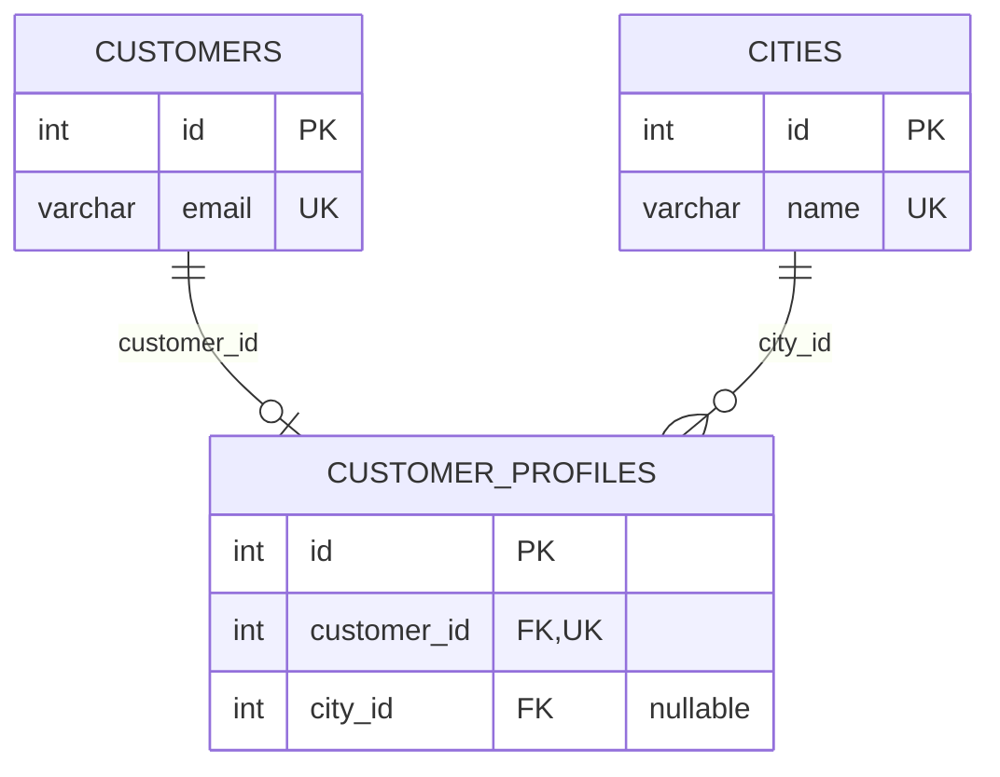
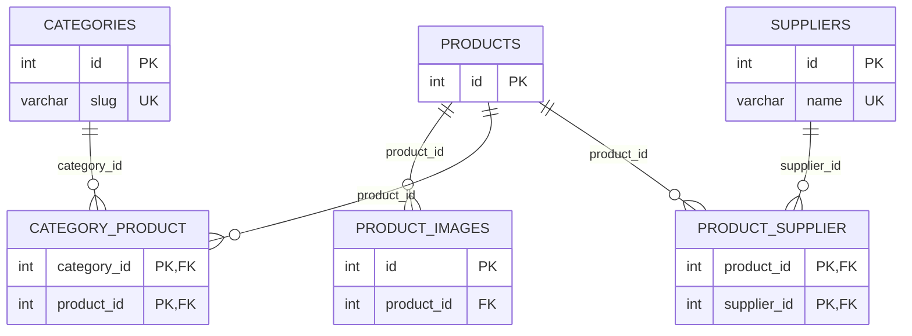
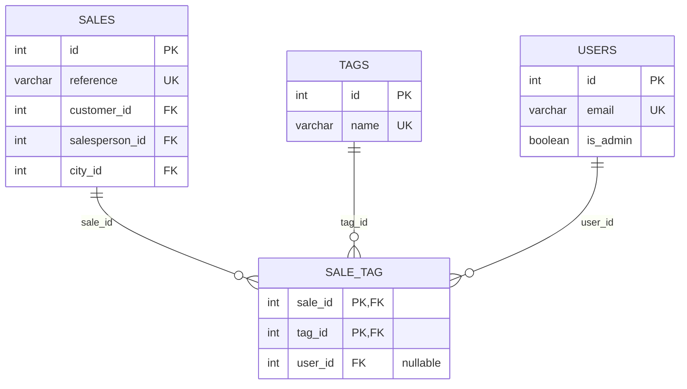
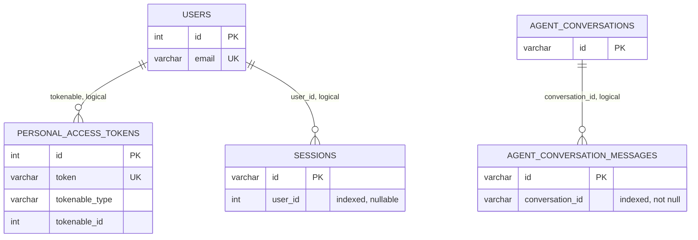

# 14. Diagram database

Dokumen ini menjelaskan isi database SQLite lokal, tabel demi tabel:

```text
database/database.sqlite
```

Ditulis untuk dibaca berdampingan dengan daftar tabel di DB client — kalau di sana terlihat "bejibun" tabel (`sale_items`, `sale_status_events`, `sale_tag`, `product_supplier`, …), bagian "Lima kelompok tabel" di bawah memetakan setiap nama ke perannya, dan bagian "Tabel demi tabel" menjelaskan kolom-kolomnya satu per satu.

Dokumen ini menunjukkan primary key, foreign key, batasan keunikan, kardinalitas relasi, perilaku penghapusan, dan jumlah baris saat ini. Prosedur verifikasi integritasnya (orphan check, uniqueness check) ada di [13. Verifikasi database SQLite](13-database-verification.md).

## Lima kelompok tabel

Semua tabel penjualan masuk ke satu dari lima kelompok:

1. **Akun dan sesi** — siapa yang boleh masuk aplikasi: `users`, `sessions`, `personal_access_tokens`, `password_reset_tokens`.
2. **Dimensi** — daftar master yang dipakai untuk mengelompokkan: `cities`, `salespeople`, `categories`, `suppliers`, `tags`. Tabel terpisah (bukan kolom teks bebas di `sales`) supaya ejaan "Jakarta" cuma ada satu baris dan laporan tidak pernah mengelompokkan dua ejaan yang berbeda.
3. **Pelanggan** — `customers` plus `customer_profiles` (one-to-one).
4. **Katalog** — `products` plus relasinya: `product_images`, `category_product`, `product_supplier`.
5. **Fakta penjualan** — `sales` sebagai header, dengan `sale_items`, `payments`, `sale_status_events`, `sale_tag` menggantung padanya.

Di luar itu hanya ada tabel framework Laravel (`cache`, `jobs`, `migrations`, …) yang tidak menyimpan data bisnis — diringkas di "Tabel framework" paling bawah.

## Tabel demi tabel

### `users` — akun login, bukan staf penjualan

| Kolom | Arti |
|---|---|
| `id` | PK. |
| `name`, `email` | Identitas login. `email` unik. |
| `email_verified_at` | Kapan email diverifikasi; null bila belum. |
| `password` | Hash bcrypt, bukan kata sandi asli. |
| `remember_token` | Token "tetap masuk" (cookie 1 hari, lihat [06. Autentikasi dan token](06-auth-and-tokens.md)). |
| `is_admin` | `tinyint(1)`: 1 = administrator meja penjualan, 0 = akun pembaca. Hanya di-set lewat `php artisan admin:ensure` atau promosi eksplisit — form pendaftaran tidak bisa membuatnya, dan form itu sendiri milik administrator. |

Poin yang paling sering membingungkan: **`users` tidak punya foreign key ke `sales`, dan `sales` tidak punya kolom `user_id`.** Akun login dan staf penjualan adalah dua tabel berbeda yang tidak terhubung (`users` vs `salespeople`). Seorang user tercatat di data penjualan hanya sebagai *aktor*: `sale_status_events.user_id` (siapa memindahkan status) dan `sale_tag.user_id` (siapa menempel tag). Keduanya boleh null dan `nullOnDelete` — kalau orangnya keluar, riwayatnya tetap ada tanpa nama. Itu audit trail, bukan kepemilikan.

### `sessions`, `personal_access_tokens`, `password_reset_tokens`

- `sessions`: sesi login web. PK-nya string acak (`id`), `user_id` menunjuk user yang login (boleh null untuk tamu), plus `ip_address`, `user_agent`, `payload`, `last_activity`. Tidak ada FK database ke `users` — pembersihan sesi ditangani perilaku sesi, bukan cascade.
- `personal_access_tokens`: token API Sanctum. Polimorfik (`tokenable_type` + `tokenable_id`) sehingga secara konsep bisa milik model lain, plus `expires_at` untuk timeout token 1 hari. Penghapusan token saat hapus akun adalah perilaku aplikasi eksplisit (`DeleteAccount`), bukan cascade.
- `password_reset_tokens`: PK-nya `email` (bukan id), tanpa FK ke `users.email`.

### Dimensi: `cities`, `salespeople`, `categories`, `suppliers`, `tags`

| Tabel | Kolom kunci | Catatan |
|---|---|---|
| `cities` | `name` unik, `province` boleh null | Provinsi boleh null karena kota bisa masuk dari data impor sebelum provinsinya diketahui — dan itu bukan alasan menolak penjualan nyata. |
| `salespeople` | `name` unik, `email` unik-boleh-null, `phone`, `commission_rate` decimal(5,2) | Komisi disimpan sebagai persentase, bukan nominal, supaya kenaikan gaji tidak mengubah bentuk riwayat komisi. |
| `categories` | `name`, `slug` unik | Slug yang unik, bukan nama — dua kategori boleh punya nama mirip selama slug-nya beda. |
| `suppliers` | `name` unik, `contact_email`, `phone` | Pemasok, bukan pelanggan: tidak ada profil kredit di sini. |
| `tags` | `name` unik, `colour` hex default `#e6e8eb` | Warna disimpan sebagai hex supaya dashboard bisa langsung memakainya sebagai background tanpa lookup. |

Kelima tabel ini adalah sisi "satu" dari relasi satu-ke-banyak, dan **hapus di sini punya dua sifat, bukan satu**. `cities` dan `salespeople` dipegang `sales` dengan `RESTRICT`: kota atau sales yang masih dirujuk penjualan historis **tidak bisa dihapus**, karena menghapusnya menulis ulang sejarah ("penjualan ini dulu di kota apa?"). `categories`, `suppliers`, dan `tags` justru `CASCADE` ke tabel junction-nya — jadi penghapusan *terlihat berhasil* sambil diam-diam melepas kategori dari produk, harga beli dari produk, dan tag dari penjualan lama. Sifat kedua lebih berbahaya justru karena tidak berbunyi, dan itulah sebabnya UI menolak menghapus selama masih direferensikan dengan kalimat yang menyebut apa yang memakainya, alih-alih menyerahkan hal itu ke database.

**Tiga dari lima tabel ini sekarang bisa ditulis dari UI**: `cities`, `salespeople`, dan `tags`, lewat satu jalur generik yang digerakkan `App\Support\ReferenceRegistry` — lihat [12. Shell administrator](12-the-admin-shell.md).

`suppliers` sekarang bisa ditambah juga, lewat `SupplierController@store` dan `POST /api/suppliers` — bukan lewat registry generik, karena nama supplier sudah punya jalur sendiri dengan `SupplierController` dan `Suppliers/Edit.vue`, dan menambahkannya ke registry akan membuat dua jalur tulis untuk satu tabel plus butir navigasi yang muncul dua kali. Kolomnya tiga dan tidak punya relasi sendiri, jadi ia cocok dengan pola generic; yang tidak cocok adalah sudah adanya halaman ubahnya.

`categories` masih satu-satunya tabel yang tidak bisa ditambah dari mana pun: pivot `category_product` ada di skema, dan tidak ada satu pun halaman yang menuliskannya.

### Pelanggan: `customers` + `customer_profiles`

`customers`: `name`, `email` unik, `phone` boleh null. Ada sejak seseorang memesan sekali.

`customer_profiles`: alamat tagihan (`address`), NPWP (`tax_id`), plafon kredit (`credit_limit` decimal(14,2)), syarat bayar (`payment_terms`, default `'COD'`, berupa prosa bebas seperti "Net 30" — bukan tabel lookup, karena syarat bayar adalah kesepakatan, bukan himpunan tertutup).

Pemisahan ini adalah **satu-ke-satu** di skema, dan alasannya siklus hidup: profil ditulis belakangan oleh meja penjualan, setelah relasinya layak di-onboarding. Kalau kolom-kolom itu menempel di `customers`, semuanya harus nullable — dan "plafon belum diketahui" akan terlihat sama dengan "plafon nol", padahal itu dua hal berbeda. Ke-satu-ke-satu-an ditegakkan `customer_id` yang **unik** (`customer_profiles.customer_id` UK + FK): database menolak profil kedua untuk customer yang sama bahkan jika dua request berpacu. Hapus customer → profil ikut terhapus (`CASCADE`); hapus kota → `city_id` profil jadi null (`SET NULL`), profilnya tetap ada.

### Katalog: `products`, `product_images`, `category_product`, `product_supplier`

`products`: `name`, `description`, `price` decimal(14,2), `stock` integer, plus `description_html` (rich text tersanitasi untuk deskripsi produk, boleh null).

`product_images`: pola relasional yang benar untuk "satu produk, banyak gambar" — `product_id` FK, `path` berkas, `alt_text` (bagian dari gambar untuk screen reader, bukan hiasan), `sort_order` eksplisit (urutan insert tidak dijamin sama antara SQLite dan Postgres). Hapus produk → gambar ikut terhapus (`CASCADE`), dengan indeks `(product_id, sort_order)`. Sejak galeri produk dibangun, tabel ini benar-benar terisi: form produk mengirim seluruh daftarnya, `SyncProductImages` mengganti barisnya dengan daftar itu, dan menghapus satu gambar ikut menghapus berkasnya — hal yang tidak bisa dilakukan gambar catatan penjualan, karena berkasnya dinamai UUID yang dibuat server sehingga satu baris memiliki satu berkas.

`category_product`: many-to-many murni produk↔kategori. Tidak ada kolom `id`; pasangan `(category_id, product_id)` adalah primary key komposit, sehingga insert ganda mustahil. Tidak membawa payload — keberadaan barisnya adalah relasinya.

`product_supplier`: many-to-many produk↔supplier **dengan payload**. Fakta yang dibawanya hanya benar untuk satu pasangan ("harga dari supplier ini untuk produk ini"): `unit_cost` (harga beli, bukan harga jual ke customer), `lead_time_days`, `is_primary` (supplier yang dihubungi duluan — sengaja advisory, bukan unique constraint, karena meja boleh punya dua supplier sambil negosiasi dan belum menentukan primer). Primary key komposit `(product_id, supplier_id)`; cascade dari kedua sisi ke tabel junction.

### Fakta: `sales`, `sale_items`, `payments`, `sale_status_events`, `sale_tag`

`sales` adalah header: siapa beli (`customer_id`), dari siapa (`salesperson_id`), di kota mana (`city_id`), kapan (`sold_at`), status apa (`status`), dan berapa totalnya. Kolom uang ada empat — `subtotal` (bruto, sebelum diskon), `discount_total` (semua potongan: lini + order), `tax_total`, `grand_total` — semuanya decimal(14,2), semuanya **dihitung server** di `CreateSale`, bukan dipercaya dari browser. Menyimpannya (bukan menghitung ulang dari items tiap baca) karena dashboard mengelompokkan dan mengurutkan di atas kolom-kolom ini; menjumlah per baris untuk me-render tabel adalah beda antara index scan dan full scan. `reference` unik dan human-facing (format `SLV-XXXXXXXX`), di-quote ke customer lewat telepon sebelum disimpan. `note` adalah rich text catatan salesperson (longText, boleh null) — gambar di dalamnya dibahas di "Gambar" bawah.

`sale_items` — yang "bejibun" di screenshot, dan wajar: 68 penjualan × beberapa produk = 141 baris. Satu baris = satu produk di satu penjualan:

| Kolom | Arti |
|---|---|
| `id` | PK. |
| `sale_id` | FK wajib ke `sales`. Hapus penjualan → barisnya ikut (`CASCADE`). |
| `product_id` | FK wajib ke `products`, tapi `RESTRICT`: produk yang dirujuk baris historis tidak bisa dihapus. |
| `quantity` | Jumlah, unsigned integer. |
| `unit_price` | **Snapshot harga saat penjualan**, decimal(14,2) — bukan bacaan lewat produk. Harga katalog boleh berubah besok; yang di-quote ke customer Maret lalu tidak boleh ikut berubah. |
| `discount_total` | Diskon khusus lini ini saja, supaya `grand_total` bisa direkonsiliasi ke kesepakatan per lini. |
| `line_total` | `(quantity × unit_price) − discount_total`, tersimpan — alasan yang sama dengan total header. |

`payments`: penyelesaian (settlement) — **satu-ke-nol-atau-satu**. `sale_id` unik: satu penjualan punya maksimal satu baris payment; pembayaran kedua atas penjualan yang sama adalah penjualan kedua atas credit note, yaitu hal berbeda dengan barisnya sendiri. Kolom: `method` (transfer/cash/credit_card/cod), `status` (unpaid/partial/paid/refunded), `amount`, `paid_at` boleh null, `reference` boleh null. `CASCADE` dari sale.

`sale_status_events`: riwayat status yang hanya ditulis, tak pernah diubah (`UPDATED_AT = null`, hanya `created_at`). `from_status` boleh null (baris pembuka "Penjualan dibuat." tidak berasal dari mana-mana), `to_status` wajib, `user_id` aktor boleh null (`SET NULL` saat user dihapus). Di data dev saat ini tepat 68 event untuk 68 sale — masing-masing satu, artinya belum ada penjualan yang pindah status.

`sale_tag`: many-to-many sale↔tag dengan payload. `note` ("kenapa tag ini menempel di sale ini" — "prioritas" artinya beda di order kilat vs yang dibatalkan) dan `user_id` penempel hidup di pasangan, bukan di tag. Primary key komposit `(sale_id, tag_id)`; Laravel menulis kedua timestamp karena pivot dideklarasikan "timed". `CASCADE` dari sale maupun tag; `SET NULL` untuk user.

## Satu user, banyak data — bagaimana tercatatnya

Karena `users` dan `salespeople` tidak terhubung, "1 user mengirim banyak gambar/data" tercatat dalam dua lapisan:

1. **Berkas dan konten**: tiap upload ke `POST /admin/uploads` mendarat sebagai berkas di disk (`uploads/<uuid>.ext`) dan URL-nya ditanam sebagai tag `` di HTML `sales.note`. Tidak ada baris per gambar — 10 gambar = 10 tag `` dalam satu kolom.
2. **Aktor**: user yang login tercatat di `sale_status_events.user_id` (saat membuat/memindahkan status) dan `sale_tag.user_id` (saat menempel tag). Satu `users.id` bisa muncul di ratusan baris event/tag — itu relasi satu-ke-banyak yang normal.

## Menulis satu penjualan — satu transaksi

`CreateSale.php:44` membungkus semuanya dalam `DB::transaction`: baris `sales` + N `sale_items` + 1 event pembuka + N `sale_tag` (via `sync`, bukan `attach`, supaya daftar tag dari form adalah himpunan final — menghapus tag di UI benar-benar menghapus). Penjualan tanpa items-nya bukan "penjualan tanpa item" melainkan record korup yang akan dihitung dashboard sebagai revenue; setengah tulis tidak boleh selamat sendiri. Catatan disanitasi saat masuk (`SanitiseRichText`), sehingga nilai tersimpan sudah aman di-render — pembaca di masa depan aman secara bawaan.

## Gambar: kolom HTML vs baris relasional

Dua mekanisme gambar hidup berdampingan, dan bedanya penting:

- **Catatan penjualan** (`sales.note`): gambar adalah tag `` di dalam HTML. Konsekuensinya: tidak bisa query ("sale dengan ≥2 foto"), tidak bisa hapus/uruti gambar ketiga saja tanpa mengedit HTML, dan **hapus sale tidak menghapus berkas di disk** (yatim, menumpuk — tidak ada FK yang bisa cascade karena gambar bukan baris). Keuntungannya: sederhana untuk konten bebas teks+foto campur.
- **Gambar produk** (`product_images`): baris relasional dengan `path`, `alt_text`, `sort_order`, cascade on delete. Dipakai galeri di form produk, dan inilah pola yang dipakai kalau suatu hari gambar catatan butuh caption, urutan, atau hapus per gambar.

Gambar utama **tidak** kolomnya sendiri: ia baris `sort_order` pertama. Karena galeri adalah urutan dan katalog menampilkan kepalanya, "gambar utama" adalah jawaban yang sama dengan "baris paling atas" — menambah `is_primary` akan membuat dua sumber kebenaran yang bisa berbeda dan tidak ada yang mengetahuinya ketika mereka berbeda.

Agar gambar catatan tampil, tiga hal harus benar bersamaan (lihat [12. Shell administrator](12-the-admin-shell.md)): symlink `public/storage` ada, `APP_URL` sesuai cara membuka aplikasi (URL `` absolut dan permanen di HTML), dan berkas tidak hilang bersama container. Di produksi `IMAGES_DISK=s3` mengganti ketiganya.

## Angka saat ini

Hasil hitung langsung dari `database/database.sqlite` dev:

| Tabel | Baris | Dibaca sebagai |
|---|---|---|
| `sales` | 68 | 68 transaksi |
| `sale_items` | 141 | rata-rata ~2 produk per sale |
| `sale_status_events` | 68 | tepat 1 per sale — belum ada yang pindah status |
| `sale_tag` | 62 | sebagian sale punya tag |
| `payments` | 19 | 19 dari 68 sale sudah ada penyelesaiannya |
| `customers` / `customer_profiles` | 6 / 6 | semua customer sudah di-onboarding |
| `products` | 15 | katalog |
| `category_product` / `product_supplier` | 11 / 11 | relasi katalog |
| `cities` / `salespeople` / `suppliers` / `tags` / `categories` | 5 / 3 / 3 / 3 / 3 | dimensi |
| `users` | 3 | akun login (2 admin, 1 biasa) |
| `product_images` | 0 | terisi lewat galeri di form produk (snapshot ini diambil sebelum galeri ada) |

## Notasi

- `PK`: kolom primary-key.
- `FK`: kolom foreign-key.
- `UK`: kunci unik.
- `||`: tepat satu baris di sisi tersebut.
- `o{`: nol atau lebih baris di sisi tersebut.
- `o|`: nol atau satu baris di sisi tersebut.

Foreign key di tabel child menunjuk ke primary key di tabel parent. Sebagai contoh:



artinya satu pelanggan dapat memiliki nol atau lebih penjualan, sedangkan setiap penjualan milik tepat satu pelanggan.

## Relasi penjualan, pelanggan, katalog, dan tag

Relasi yang ditegakkan dikelompokkan ke dalam empat diagram terfokus. Entitas sengaja diulang di mana domain yang berbeda bertemu dengannya, sehingga setiap diagram tetap dapat dibaca secara independen.

### Header penjualan dan riwayat



### Profil pelanggan



### Katalog



### Penandaan penjualan



## Inventaris relasi

| Induk → anak | Foreign key dan constraint | Kardinalitas | Perilaku penghapusan |
|---|---|---:|---|
| `customers` → `sales` | `sales.customer_id`, wajib | Satu-ke-banyak | `RESTRICT`; pelanggan dengan penjualan tidak dapat dihapus |
| `salespeople` → `sales` | `sales.salesperson_id`, wajib | Satu-ke-banyak | `RESTRICT`; penjualan historis tetap menyimpan salesperson-nya |
| `cities` → `sales` | `sales.city_id`, wajib | Satu-ke-banyak | `RESTRICT`; penjualan historis tetap menyimpan kota pengirimannya |
| `sales` → `sale_items` | `sale_items.sale_id`, wajib | Satu-ke-banyak | `CASCADE`; menghapus penjualan akan menghapus baris-barisnya |
| `products` → `sale_items` | `sale_items.product_id`, wajib | Satu-ke-banyak | `RESTRICT`; produk yang dirujuk oleh baris historis tidak dapat dihapus |
| `sales` → `payments` | `payments.sale_id`, wajib dan unik | Satu-ke-nol-atau-satu | `CASCADE`; menghapus penjualan akan menghapus penyelesaiannya |
| `sales` → `sale_status_events` | `sale_status_events.sale_id`, wajib | Satu-ke-banyak | `CASCADE`; menghapus penjualan akan menghapus riwayatnya |
| `users` → `sale_status_events` | `sale_status_events.user_id`, boleh null | Satu-ke-banyak | `SET NULL`; menghapus pengguna akan mempertahankan event audit |
| `customers` → `customer_profiles` | `customer_profiles.customer_id`, wajib dan unik | Satu-ke-nol-atau-satu | `CASCADE`; menghapus pelanggan akan menghapus profilnya |
| `cities` → `customer_profiles` | `customer_profiles.city_id`, boleh null | Satu-ke-banyak | `SET NULL`; menghapus kota akan mempertahankan profil |
| `products` → `product_images` | `product_images.product_id`, wajib | Satu-ke-banyak | `CASCADE`; menghapus produk akan menghapus gambar-gambarnya |
| `products` ↔ `categories` | `category_product.category_id` dan `category_product.product_id`, primary key komposit | Banyak-ke-banyak | `CASCADE` dari salah satu induk ke tabel junction |
| `products` ↔ `suppliers` | `product_supplier.product_id` dan `product_supplier.supplier_id`, primary key komposit | Banyak-ke-banyak dengan payload | `CASCADE` dari salah satu induk ke tabel junction |
| `sales` ↔ `tags` | `sale_tag.sale_id` dan `sale_tag.tag_id`, primary key komposit | Banyak-ke-banyak dengan payload | `CASCADE` dari salah satu induk ke tabel junction |
| `users` → `sale_tag` | `sale_tag.user_id`, boleh null | Satu-ke-banyak | `SET NULL`; menghapus pengguna akan mempertahankan pasangan tag |

Junction yang membawa payload adalah:

- `product_supplier.unit_cost`
- `product_supplier.lead_time_days`
- `product_supplier.is_primary`
- `sale_tag.note`
- `sale_tag.user_id`
- `sale_tag.created_at`
- `sale_tag.updated_at`

`category_product` tidak membawa payload; keberadaan baris composite-key-nya adalah relasinya.

## Asosiasi logis tanpa foreign key database



Edge-edge ini adalah asosiasi aplikasi yang nyata, tetapi tidak ditegakkan dengan constraint `FOREIGN KEY`:

- `personal_access_tokens` menggunakan `tokenable_type` dan `tokenable_id` polimorfik Sanctum, sehingga baris token secara konseptual dapat milik tipe model lain.
- `sessions.user_id` diindeks tetapi tidak dibatasi; pembersihan sesi ditangani oleh perilaku sesi bukan oleh delete cascade.
- `agent_conversation_messages.conversation_id` diindeks tetapi tidak dibatasi.
- Penghapusan token saat penghapusan akun adalah perilaku aplikasi eksplisit karena tidak ada `ON DELETE CASCADE`.

## Tabel framework

Tabel-tabel berikut memiliki primary key tetapi tidak menyimpan data bisnis dan tidak memiliki relasi foreign-key masuk atau keluar yang ditegakkan:

- `migrations` — catatan migration yang sudah jalan.
- `password_reset_tokens` — memakai `email` sebagai primary key, tanpa FK ke `users.email`.
- `cache`, `cache_locks` — cache database driver.
- `jobs`, `job_batches`, `failed_jobs` — antrean.
- `agent_conversations`, `agent_conversation_messages` — riwayat asisten AI (relasi logis antar keduanya, lihat diagram di atas).

## Verifikasi dan ruang lingkup

Dokumen ini diperiksa terhadap:

- Definisi tabel SQLite langsung
- Deklarasi primary-key
- Deklarasi foreign-key dan aksi penghapusan
- Indeks unik dan primary key komposit
- Relasi Eloquent `BelongsTo`, `HasMany`, `HasOne`, dan `BelongsToMany` yang sesuai
- `docs/13-database-verification.md`

SQLite melaporkan kolom numerik secara generik dan tidak menegakkan presisi Postgres, sehingga dokumen ini mengidentifikasi struktur relasi bukan presisi numerik produksi. Perilaku RLS khusus Postgres juga berada di luar ruang lingkup dokumen ini.
