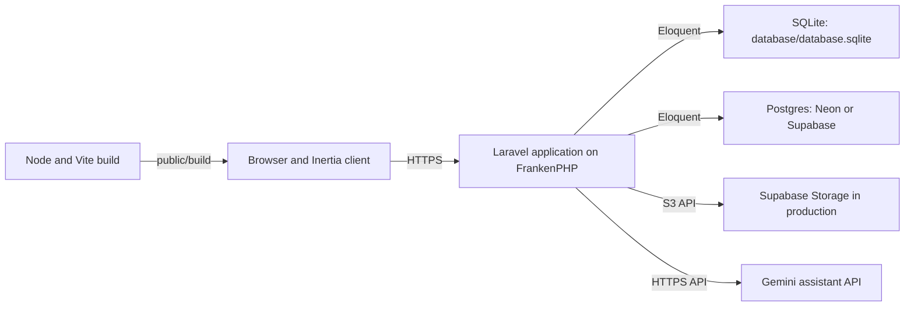

# 00. Topologi proyek

Ini adalah peta sistem Laravel saat ini. Ia menjawab di mana perilaku utama berada dan bagaimana bagian-bagiannya terhubung. Perilaku rinci tetap ada di panduan tertaut; dokumen ini tidak menduplikasinya.

## Topologi runtime



- Pengembangan lokal default ke SQLite melalui `DB_CONNECTION=sqlite` (`config/database.php:20`, `.env.example:35`).
- Produksi memakai Postgres. Deployment membedakan koneksi aplikasi pooled dari koneksi migrasi langsung; lihat [10. Deployment ke Vercel](../10-deploying.md).
- Unggahan memakai penyimpanan lokal di pengembangan dan Supabase Storage melalui S3 di produksi; lihat `config/images.php:12-22`.
- Build Vite berjalan di bawah Node, tetapi produksi hanya menyajikan PHP dan aset yang ter-build; lihat `Dockerfile.vercel:1-18` dan `Dockerfile.vercel:49-74`.
- SSR Inertia dinonaktifkan karena runtime produksi tidak punya proses Node yang menjawab; lihat [11. UI web](../11-the-web-ui.md).

## Topologi permintaan

- Rute peramban tamu menangani Masuk dan Daftar.
- Rute mandiri yang terautentikasi menangani Keluar dan akun milik pemanggil sendiri.
- Rute khusus administrator menangani Dashboard, Produk, Penjualan, Pelanggan, Supplier, unggahan, dan permintaan asisten.
- API memiliki rute akun dan katalog terpisah yang diautentikasi Sanctum.
- Akses administrator ditegakkan sekali dengan alias middleware `admin`:

```php
// bootstrap/app.php:41-43
$middleware->alias([
    'admin' => EnsureAdmin::class,
]);
```

Periksa tabel rute live, bukan menyalinnya ke sini:

```sh
php artisan route:list --path=api --except-vendor
php artisan route:list --path=sales --except-vendor
php artisan route:list --path=account --except-vendor
```

Perintah-perintah itu dijalankan saat dokumen ini ditulis dan saat ini menunjukkan 11 rute API, empat rute penjualan, dan tujuh rute akun.

## Topologi backend

```text
app/Http/Controllers/Api/      Account, product, and token controllers
app/Http/Controllers/Web/      Account, assistant, dashboard, directory, login,
                                product, registration, sale, and upload controllers
app/Http/Requests/              Validation shared by the API and web surfaces
app/Http/Resources/             Account and product JSON shapes
app/Http/Middleware/            Inertia sharing and administrator enforcement
app/Actions/                    Business operations shared by both surfaces
app/Models/                     Sales, catalogue, customer, and account models
app/Enums/                      Sale lifecycle states
app/Ai/                         Assistant agents, resources, and tools
app/Console/Commands/           Interactive administrator provisioning
routes/api.php                  Token API surface
routes/web.php                  Browser surface
bootstrap/app.php               Routing, middleware, and exception behavior
```

Validasi dan operasi bisnis sengaja berada di luar kontroler bila kedua permukaan memakainya. Misalnya, pendaftaran dan pembaruan akun berbagi validasi permintaan, sementara aksi bersama memiliki pembaruan akun, penghapusan, pembuatan penjualan, dan ringkasan penjualan.

## Topologi frontend

```text
resources/views/app.blade.php   Inertia root document
resources/views/auth/           JavaScript-free login and registration pages
resources/css/app.css           Tailwind entry point and theme
resources/js/app.js             Inertia entry point
resources/js/pages/             One Vue component per application page
resources/js/layouts/           Admin shell used by signed-in pages
resources/js/components/        Sidebar, topbar, panels, editor, chart, and dialogs
resources/js/shared/            Shared route map and rupiah formatting
vite.config.js                  Build and frontend entry configuration
```

Vue tidak pernah meng-hardcode URL backend. PHP membagikannya melalui `HandleInertiaRequests`, yang peta rutenya saat ini mencakup tujuan dashboard, produk, penjualan, pelanggan, supplier, akun, asisten, unggahan, dan keluar (`app/Http/Middleware/HandleInertiaRequests.php:73-89`).

## Topologi data dan akun

- Tabel penjualan, katalog, pelanggan, tag, pembayaran, dan riwayat status membentuk domain meja penjualan.
- `users.is_admin` memisahkan akun biasa dari administrator.
- `personal_access_tokens` mendukung autentikasi API Sanctum.
- `sessions` mendukung autentikasi peramban.
- Gambar yang diunggah berada di luar database relasional.
- Lihat [13. Verifikasi database SQLite](../13-database-verification.md) untuk integritas lokal.
- Lihat [14. Diagram database](../14-database-diagram.md) untuk kunci, kardinalitas, dan perilaku hapus.
- Lihat [06. Autentikasi dan token](../06-auth-and-tokens.md) untuk otorisasi dan siklus hidup token.
